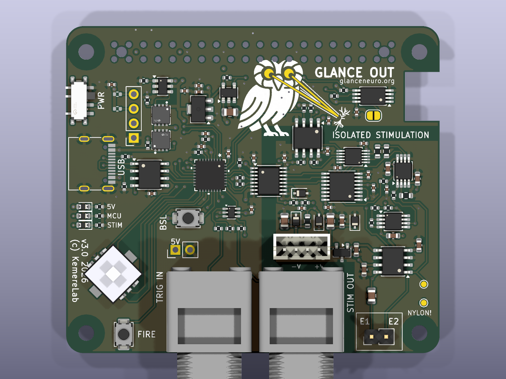
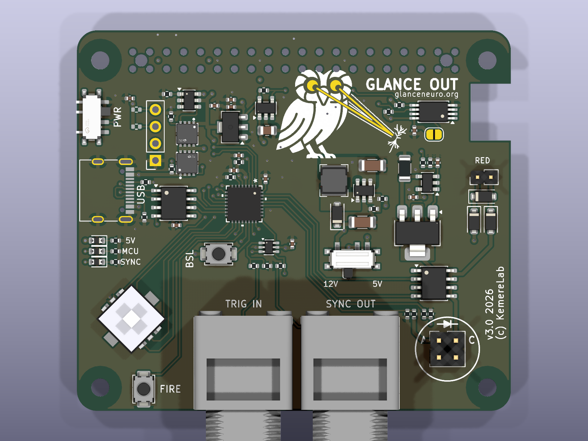
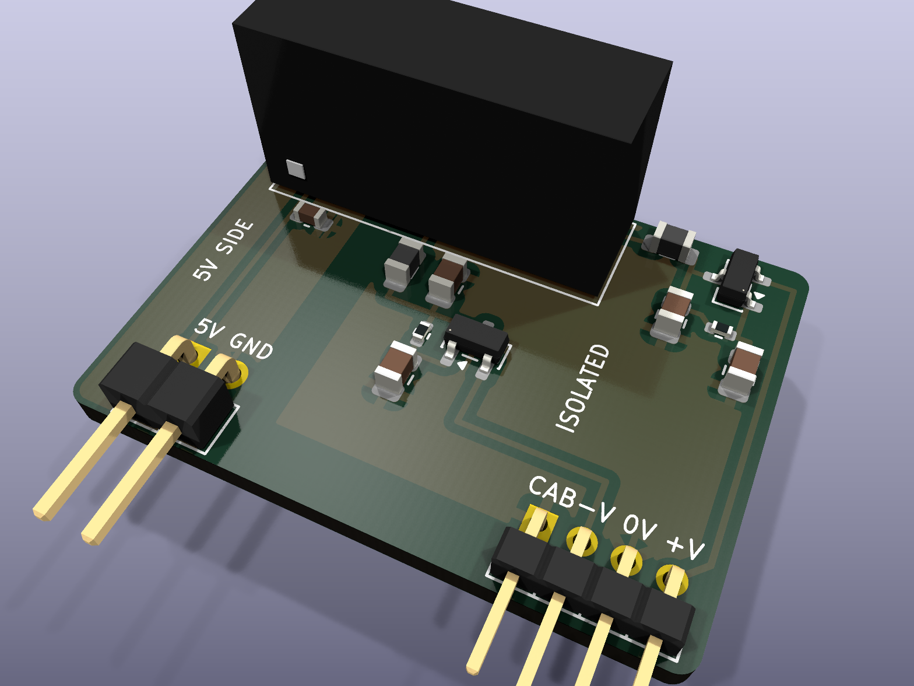
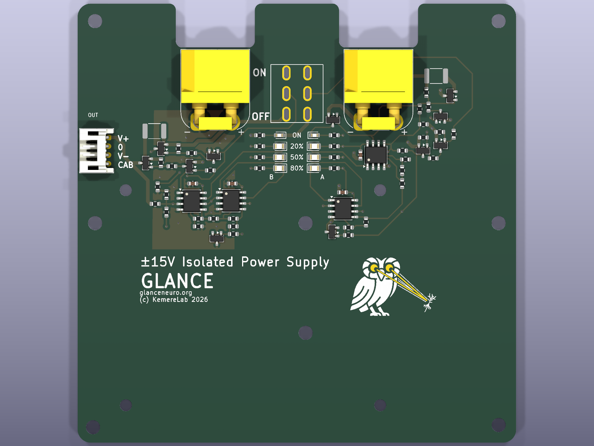

# Glance out

The output side of **Glance**: stimulation HATs for the Raspberry Pi, their power boards, the MCU firmware and the Pi
software and OS images.  A Pi 4 with one of these HATs delivers timed optogenetic laser pulses or isolated
constant-current electrical stimulation, triggered from the Pi, a BNC input or the network, with an OLED and joystick
for use at the rig.

| | |
|---|---|
|  |  |
| **StimHAT** — isolated constant-current stimulator | **LaserDriverHAT** — laser-diode driver |
|  |  |
| **DCDCPod** — isolated ±15 V supply pod for the StimHAT | **SimpleBatteryPack** — battery ±V supply for the StimHAT |

## The boards

**StimHAT** (`hardware/StimHAT/`).  A 65 × 57 mm four-layer HAT.  The west half is the shared core: an MSPM0G1507
microcontroller on the Pi's UART with its own USB-C port and CH340N for stand-alone use, the HAT ID EEPROM, BNC
trigger in and sync out, a five-way joystick and a FIRE button, and either the Adafruit OLED bonnet stacked above or a
0.91" OLED module on the board.  The east half, behind a 2.5 mm isolation barrier crossed only by two digital
isolators, is a cathodic-first biphasic constant-current stimulator: a DAC60501 set-point, an OPA2192 current source
with a 2.49 kΩ sense resistor (502 µA full scale, 0.12 µA per code), a DG418 shorting switch between pulses and a
window comparator that latches a fault when the electrode voltage leaves ±12.35 V.  The isolated side takes its ±V
from the DCDCPod or the SimpleBatteryPack.

**LaserDriverHAT** (`hardware/LaserDriverHAT/`).  The same core with the laser-diode driver in place of the
stimulator: an MT3608 boost to 12 V, a TLV2371 current servo on a 2 Ω shunt set by the MCU's DAC (about 100 mA per
volt), a dual-FET switch pair for pulse and dummy load driven by a hardware timer, and a photodiode monitor.  The
driver block is the hand-made layout of the earlier plug-in laser module, carried over intact.

**DCDCPod** (`hardware/DCDCPod/`).  A 31 × 22.5 mm board that stands on the StimHAT between the OLED bonnet and the
BNCs: a RECOM RB-0515D/HP 5 V → ±15 V converter, an LC filter and a capacitance multiplier per rail, giving quiet
±13.5 V for the stimulator from the Pi's 5 V.

**SimpleBatteryPack** (`hardware/SimpleBatteryPack/`).  Two 4S packs in series with a centre tap, an ON/OFF switch and
a gauge, for a fully battery-powered stimulator when even the pod's residual ripple matters.

## Software

- **Firmware** (`firmware/`): one source tree builds the three MCU images (`BOARD=stim|laser|rev2`).  The MCU keeps
  the pulse timing, state machine and safety interlocks; the Pi only configures and triggers.  The binary protocol in
  `firmware/protocol.h` is mirrored by `pi/protocol.py` and cross-checked in CI.
- **Pi** (`pi/`): the `laserhat` Debian package — a C broker that owns the UART and the trigger GPIOs and accepts
  low-latency UDP triggers, an OLED daemon, a web GUI, `laserhat-flash` (programs the MCU over SWD from the Pi's
  GPIOs) and `laserhat-eeprom` (programs the HAT ID EEPROM).  The board type comes from the EEPROM; the firmware
  reports its own and the two are cross-checked.
- **Releases**: a `v*` tag makes CI build the debs and golden Raspberry Pi OS images (`laserhat-raspios-lite-*.img.xz`)
  with everything installed.  Flash an image, boot, program the EEPROM once, run `sudo laserhat-flash`.

## Getting started

1. Flash the latest release image to a card and boot the Pi with the HAT fitted.
2. Program the HAT's identity once: `sudo laserhat-eeprom write stim --yes` (or `laser`) with JP1 open, close JP1,
   reboot.  `laserhat-eeprom read` shows what the Pi sees.
3. `sudo laserhat-flash` programs the matching firmware and reports the MCU's version and board.
4. Open the web GUI (port 80 on the Pi) or use the joystick and OLED; triggers come from the FIRE button, the TRIG IN
   BNC, Pi GPIO 18, or UDP on the wired port.

`pi/PROVISIONING.md` has the details (services, network, displays, EEPROM buses), `hardware/<board>/README.md` the
design notes, pin maps and audit records of each board, `docs/REPO_MAP.md` the directory index, and `CLAUDE.md` the
working guide for agents.

## History

The first generations — a HAT with plug-in laser and e-stim modules and a relay-switched battery pack — are archived at
tag `archive/pre-glance-cleanup`, with their design history in `docs/history/REV2_NOTES.md`.  Software identifiers
(`laserhat` package, commands, services and variables) keep those names for now.
